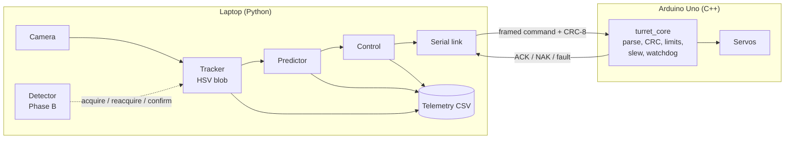
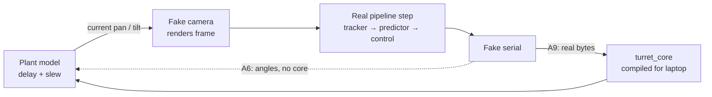

# Predictive Tracking Turret — Product Requirements

Written 2026-11-15. Replaces `PLAN.md`. This document says **what** must be true and **how to check it**. Every "how to build it" decision is yours; where a requirement forces a choice, the options are listed without a pick.

---

## 1. Purpose

A two-axis pan-tilt camera turret that tracks a moving object and aims ahead of it. A laptop runs perception and control in Python; an Arduino Uno drives two SG90 servos over USB serial.

It is a portfolio project for firmware/embedded, controls, test/validation and rotational new-grad roles. It exists to make three claims true, in this order:

1. **Controls:** prediction reduced tracking error from X to Y (measured).
2. **Test/validation:** the system was validated before hardware existed, using a software-in-the-loop (SIL) simulator that runs the real firmware code, plus an automated test suite in CI.
3. **Generalization:** the target is selected from 80 object classes instead of hand-tuned per object.

## 2. Fixed constraints

| Constraint | Detail |
|---|---|
| Stack | Python, OpenCV (including `cv2.dnn` and contrib), NumPy, pyserial, Arduino C++. No PyTorch, Ultralytics or cloud APIs. |
| Test-only tools | Allowed: `pytest`, `pytest-cov`, `g++`, `doctest`, `arduino-cli`, GitHub Actions. |
| Authorship | You write the code. Claude reviews, explains and helps debug. Claude never commits or merges. |
| Method | Test each unit alone, then test again after each single integration. |
| Latency rule | The per-frame loop stays lightweight. A detector may run only to acquire, reacquire, or periodically confirm the target. |
| Config | Every tunable value lives in `src/config.py`. |
| Hardware | None until 2027-01-04. Laptop webcam only. |

## 3. Dates and budget

| Date | Meaning |
|---|---|
| 2026-12-03 | Offline kit ready (A11) |
| 2026-12-05 | "Core validated" (Phase A). Travel starts; only offline train-ride work after. |
| 2027-01-04 | Hardware access. Phase C starts. |

Budget to Dec 5: about 15–30 hours. Phase A is estimated at about 35 hours (estimates are rough guesses). **So Phase A has a cut line:** A0–A6 make the résumé claim true and come first. A7–A10 are done as hours allow and spill into Phase B. A11 has a fixed date regardless.

## 4. Architecture

**On hardware**

**In simulation (A6, then A9)**

The camera, serial port and servos are replaced. The pipeline in the middle is the same code that runs on hardware.

### Requirements that cross every module

These exist to prevent rework. Each one is needed by a later milestone.

- **X1 – Swappable devices.** The loop receives its camera and serial link as arguments. Tests and the simulation pass in fakes. (Needed by A6, A9.)
- **X2 – Steppable pipeline.** One iteration of tracker → predictor → control is callable as a function of (frame, timestamp) with no window display, no sleeping and no reading the wall clock inside it. Display and timing live in an outer shell. (Needed for deterministic simulation and regression tests.)
- **X3 – Time is an input.** Python logic takes timestamps as arguments. The firmware core is told the current time; it never reads a clock itself. (Needed for A7 watchdog tests and A9.)
- **X4 – Tracker bounds are runtime values.** The tracker takes its HSV bounds as input rather than reading module-level constants at call time. (Needed by B3 auto-HSV.)
- **X5 – One source of truth for angle limits.** Firmware limits and Python limits cannot drift apart silently. Options: a generated header, a startup handshake where the firmware reports its limits, or a test that parses both files.
- **X6 – Same telemetry in simulation and on hardware.** One CSV schema for both, so one analysis tool reads both.

---

## 5. Phase A — core validated (by Dec 5)

Recommended order is top to bottom. `Depends on` shows what is actually required first.

### A0 — Environment and test scaffolding (~2 h)

**Requirements**
- A virtual environment; `requirements.txt` pinned to the versions now installed (OpenCV 4.13, NumPy 2.5.2, pyserial 3.5); `requirements-dev.txt` for test-only tools.
- `pytest` runs from the repo root and finds tests.
- A GitHub Actions workflow that runs `pytest` on every push. It grows as later milestones add the `g++` tests and the `arduino-cli` compile.

**Acceptance**
- A fresh clone plus the documented install steps gives a passing `pytest` run with at least one real test.
- The workflow shows green on GitHub for a push you make.

**Yours to decide:** runner OS (see §9 note 6), test folder layout, whether to add a linter.

### A1 — Audit of existing work, Milestones 0–3 (~3 h)

**Requirements**
- You audit `camera.py`, `tracker.py`, `serial_link.py`, `turret_listener.ino`, `config.py` and the four `tools/` scripts, and write findings to a file before seeing Claude's.
- Claude then gives its findings ranked by severity. You reconcile the two lists into one, each item marked fix-now, fix-in-milestone-N, or won't-fix with a reason.

**Known problems the audit must cover**
1. The firmware's serial parser is commented out and replaced by a sweep test.
2. Firmware limits (pan 15–180, tilt 125–360, startup tilt 220) are impossible for a 0–180° servo and disagree with `config.py`.
3. The lemon hue range is 9–127 of 179, far too wide.

**Acceptance:** the reconciled findings file exists and every item has a disposition.

### A2 — Tracker fixes and tests (~3 h) · depends on A0, A1

**Requirements**
- Meets X4.
- Supports hue ranges that wrap around the ends of OpenCV's 0–179 hue scale (red).
- Still returns a centroid or "no target", and still rejects blobs under the minimum area.

**Acceptance (automated)**
- Synthetic images with a known blob position: centroid within a stated pixel tolerance.
- A red blob is found using a wrapping range; a blob below minimum area is rejected; an empty frame gives "no target"; with two blobs the larger wins.
- At least one recorded clip from the laptop webcam: detection rate over the clip is at or above a threshold you set and record.

**Yours to decide:** how a wrapping range is represented, the tolerance, how test images are generated.

### A3 — Control (~2 h) · depends on A0

**Requirements**
- Converts pixel offset from frame center into new pan/tilt commands.
- Baseline law: commanded angle changes by gain × pixel error each step, with a deadzone and a per-step limit. Output always inside the soft limits.
- Meets X3. No device access.

**Acceptance (automated)**
- Zero error gives no change. Error inside the deadzone gives no change.
- A huge error is clamped to the per-step limit. Commands never leave the soft limits.
- Sign test: a target right of center moves pan in the direction that reduces the error under a stated sign convention. (The physical direction is confirmed in Phase C.)

**Yours to decide:** function or class shape, units, whether pan and tilt share a gain.

**Worth understanding for interviews:** this law is integral action on pixel error. The closed loop behaves like a first-order system whose time constant is set by the gain and the frame rate.

### A4 — Predictor (~2 h) · depends on A0

**Requirements**
- Constant-velocity extrapolation from recent positions.
- Lead is expressed in **seconds**, not frames. Meets X3.
- Defined behavior with too little history, after a "no target" gap, and after a target reset.
- Written fresh; the old prototype is a reference only.

**Acceptance (automated)**
- Constant-velocity input: prediction matches the true future position within tolerance.
- Stationary input: prediction equals the current position.
- Uneven timestamps still give the right answer.
- One or zero samples: returns the documented fallback and does not crash.

**Yours to decide:** history length, velocity estimate (two-point, average, least-squares), any smoothing.

### A5 — Pipeline step, telemetry and metrics (~3 h) · depends on A2, A3, A4

**Requirements**
- Meets X1, X2, X6.
- Prediction can be turned on and off from config.
- Telemetry records at least: timestamp, raw target position, predicted position, pixel error, commanded pan/tilt, loop duration, prediction flag.
- A metrics function computes mean, median and 95th-percentile error magnitude from a telemetry log. (A command-line wrapper comes in B4.)

**Acceptance (automated)**
- A scripted sequence of frames through the step function produces the expected command sequence.
- A log written then read back gives the same values; metrics on a hand-made log match hand-computed numbers.

### A6 — Closed-loop simulation, version 1 (~5 h) · depends on A5

This milestone closes the gap between the résumé and the code.

**Requirements**
- A fake camera that **renders** each frame from the turret's current pan/tilt and a scripted target motion. The real tracker processes these frames.
- A fake serial link at the "send angles" level (no wire format yet).
- A minimal plant: a fixed delay plus a slew-rate limit. Without delay, prediction cannot show a benefit.
- Runs in simulated time, with a fixed random seed. Two runs give identical logs.
- Motion profiles: at least step, constant velocity, and sine. Each runs with prediction off and on.
- All plant parameters live in one place, each labeled as an assumption with its source.

**Acceptance**
- An automated test asserts two seeded runs are identical.
- An automated test asserts the loop converges on a stationary target.
- A results table (per profile, prediction off vs on) is saved in the repo.
- Report honestly where prediction does not help.

**Yours to decide:** how frames are rendered, plant equations, profile parameters, where results are stored (`logs/` is gitignored, so not there).

**When A6 passes:** the résumé wording "prediction validated in SIL simulation" is true.

### A7 — Firmware core (~6 h) · depends on A0, A1

**Requirements**
- Logic lives in `turret_core` files with no `Arduino.h`, compiled both by the Arduino toolchain and by `g++`. The `.ino` only touches hardware.
- `turret_core` sits inside the sketch folder (`arduino/turret_listener/`, or its `src/` subfolder). The Arduino build does not see files elsewhere.
- Uses fixed-width integer types. `int` is 16 bits on the Uno and 32 on your laptop; without fixed widths, host tests can pass while the board fails.
- No Arduino `String` and no heap allocation in the core. The Uno has 2 KB of RAM, and `String` does not exist on the host.
- Protocol: framed ASCII with a CRC-8, at 115200 baud. Replies with an acknowledgement or an error and reason.
- A malformed, over-long or bad-checksum frame never moves a servo. The parser recovers and accepts the next good frame.
- Hard angle limits and a slew-rate limit enforced on the device.
- Watchdog: no valid command for a timeout (start at about 250 ms) → hold position and report a fault. Meets X3.
- A debug mode that accepts unchecked commands for typing in the Serial Monitor. It must be impossible to leave on by accident.

**Acceptance (automated, `doctest` on `g++`)**
- Valid frame → correct angles and acknowledgement.
- Bad CRC, missing fields, non-numeric fields, over-long frame, garbage before a valid frame: each rejected with no motion, then a following good frame is accepted.
- Out-of-range angles are clamped to hard limits.
- Slew limit: a large commanded jump is reached over several time steps, never in one.
- Watchdog: fault after the timeout, none before it, defined recovery when commands resume.
- The sketch compiles with `arduino-cli` for the Uno.

**Yours to decide:** frame layout, CRC polynomial, reply format, how the fault clears, how debug mode is enabled, safe startup position (final value needs the bench).

### A8 — Host side of the protocol (~2 h) · depends on A7

**Requirements**
- `serial_link.py` builds frames and reads replies. A lost or failed reply never blocks or crashes the loop.
- The host sends at a steady cadence in every state, including while holding. Otherwise the watchdog trips whenever the host is busy or idle.
- Meets X5.

**Acceptance (automated)**
- **Shared test vectors:** one file of frames and expected CRCs, checked by both the Python tests and the C++ tests.
- Timeout and error replies are handled without raising into the loop.

### A9 — Firmware in the loop (~4 h) · depends on A6, A7, A8

**Requirements**
- The simulation's fake serial link now passes real bytes to the compiled `turret_core`. The plant takes its commands from the core's output.
- Still deterministic and in simulated time.

**Acceptance (automated)**
- A6's profiles run through the real core; results match A6's within a stated margin, or the difference is explained (the device slew limit will change them).
- Fault injection: corrupted bytes and a stalled host produce the expected rejection and watchdog behavior, visible in telemetry.

**Yours to decide:** how Python reaches the core. This was chosen as a host executable over stdin/stdout; see §9 note 2 before building it.

### A10 — Regression baselines and full CI (~2 h) · depends on A6 (A9 if done)

**Requirements**
- Committed baseline results. A test fails if error for any profile rises above baseline plus a margin.
- CI runs `pytest`, the `g++` tests and the `arduino-cli` compile.
- Coverage is reported, with no target.

**Acceptance:** deliberately worsening a gain makes the regression test fail; reverting makes it pass. CI is green.

### A11 — Offline kit (due Dec 3, ~1 h)

**Checklist:** virtual environment fully installed · `doctest` header in the repo · `arduino-cli` and the AVR core installed · YOLOX weights downloaded · test clips recorded (see §9 note 7) · this PRD and the OpenCV docs you need available offline.

**Acceptance:** with Wi-Fi off, the full test suite and the simulation run.

---

## 6. Phase B — Dec 5 to Jan 4 (offline-capable)

### B1 — Plant model and controls study
- Servo and camera parameters from datasheets (SG90: about 0.1 s per 60°), recorded as assumptions.
- Sweep prediction lead time. Show whether the best lead matches the injected latency.
- Compare three cases: baseline, prediction, velocity feedforward.
- **Acceptance:** a results table and plot data for all three; regression baselines updated.

### B2 — Target selection and detector
- YOLOX from the OpenCV Model Zoo (Apache-2.0) through `cv2.dnn`. Weights fetched by a script, not committed.
- Version 1 selection: a printed numbered list of the 80 classes; the user enters a number or exact name at a prompt or as an argument. A key re-prompts.
- Several matches: choose the one nearest frame center among those above a confidence threshold.
- **Acceptance:** selection parsing is unit-tested (valid, invalid, out of range). On recorded clips the right object is chosen. Detector latency is measured and recorded.

### B3 — Auto-HSV and tracking state machine
- HSV bounds computed from the central part of the detection box using a hue histogram.
- States: IDLE → ACQUIRING → TRACKING → LOST. Lost after N frames without a target; turret holds; detector reruns; idle after a timeout.
- Every K frames the detector confirms the tracked blob overlaps a detection of the selected class.
- **Acceptance:** every transition is unit-tested with a fake detector and fake tracker. On clips, auto-HSV tracking rate is recorded per object. Known limit: multi-colored objects; document results honestly.
- **Yours to decide:** histogram statistics, N and K, whether the periodic check runs inline or in a thread (§9 note 5).

### B4 — `analyze_log.py`
Command-line wrapper over the A5 metrics function. Works on simulation and hardware logs.

### B5 — Simulation demo video
Side by side, prediction off vs on, same motion profile.

### B6 — Hardware bring-up plan
A written, ordered checklist for Jan 4, each step with its expected result. Must include: power and common-ground checks, single-servo test, physical limit measurement, firmware self-test, watchdog test (unplug the host mid-run), step-response test, sign/direction check, closed loop, and a simulation-vs-hardware log comparison.

## 7. Phase C — hardware (from Jan 4)

- Follow B6. Measure the real limits and replace the placeholders.
- Step-response test → update plant parameters → rerun the simulation → report the sim-vs-real gap.
- Three logged runs (slow, medium, fast), prediction off and on. These numbers go on the résumé.
- Side-by-side hardware video. README updated with real results.
- A software stop key (hold, then detach servos) is tested before any closed-loop run.

## 8. Stretch (only after everything above)

Color + class prompts ("red cup") · typing inside the video window · synonyms and "did you mean" · a classical tracker fallback for multi-colored objects · 3D visual simulation.

---

## 9. Notes and open risks

1. **Budget.** Phase A is over budget on purpose; the cut line after A6 is the safeguard. If A6 slips past about Nov 29, drop A9 before dropping tests.
2. **Reaching the firmware core from Python (A9).** The stdin/stdout choice has costs on Windows: output buffering, newline translation in text mode, and no simple non-blocking pipe reads. It also needs a test-only way to advance the core's clock. Loading the core as a shared library through `ctypes` avoids all of these and still feeds the real parser byte by byte. Worth re-deciding before A9.
3. **Watchdog vs host pauses.** Loading the detector model or a slow detection can exceed 250 ms. A8's steady-cadence requirement and A7's fault-recovery choice must be designed together.
4. **Two limiters.** Python and the firmware both limit step size. Decide which is the safety limit and which is the tuning knob, and make the simulation include both.
5. **Detector hitch.** A 50–150 ms detection inside the loop drops frames and spikes tracking error. Telemetry logs loop duration so this is visible.
6. **CI runner.** On Ubuntu runners `opencv-python` needs the `libgl1` system package; Windows runners match your machine but are slower. Tests must never open a window.
7. **Recorded clips are public.** Keep faces, screens and anything personal out of frame. Keep clips short.
8. **Unknown until the bench:** real servo limits, direction signs, camera index, true latency. Marked as placeholders in config.

## 10. Definition of done

- **Dec 5:** A0–A6 pass, plus as much of A7–A10 as the hours allowed; A11 done Dec 3; CI green.
- **Jan 4:** Phase B done; bring-up plan printed.
- **Project:** hardware numbers measured, video recorded, README shows real results.
