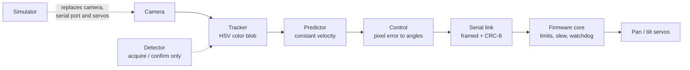

# Predictive Tracking Turret

A two-axis pan-tilt camera turret that tracks a moving object and aims ahead of it. A laptop runs vision and control in Python with OpenCV; an Arduino Uno drives two servos over USB serial.

**Status: in progress.** Camera capture and color tracking work on a live webcam. Control, prediction, the new firmware and the simulator are being built now. Hardware testing starts in January 2027. This page is updated as each part is finished and tested; nothing below is claimed before it works.

## Why it is built this way

- **The control loop stays lightweight.** Tracking runs a color threshold every frame, and prediction is constant-velocity extrapolation. Heavier models add latency, and latency is what makes a turret trail its target. In earlier experiments a learned predictor (an LSTM) only tied the constant-velocity baseline, so the simple one wins under a latency budget.
- **Detect, then track.** An object detector will run only to find the target, to find it again when lost, and occasionally to confirm it. It never runs every frame.
- **Tested before the hardware exists.** The plan is a software-in-the-loop simulator: a fake camera renders what the turret would see, the real tracking and control code runs on those frames, and the commands go through the same firmware logic that runs on the Arduino, compiled for the laptop.
- **Firmware that fails safely.** Commands are framed and checksummed. A corrupted command never moves a servo, and if the laptop stops talking, a watchdog holds position and reports a fault.

## Architecture



## Progress

| Part | State |
|---|---|
| Camera capture | Working on a live webcam |
| Color-blob tracker | Working on a live webcam; being reworked for red hues and runtime color bounds |
| Control and prediction | In progress |
| Closed-loop simulator | In progress |
| Firmware: checksummed protocol, watchdog, host-side unit tests | In progress |
| Automated tests and CI | In progress |
| Target selection from 80 object classes | Planned |
| Hardware bring-up and measured results | January 2027 |

## Results

None yet. Simulation results (tracking error with prediction off and on) will be posted here first, followed by hardware measurements and a side-by-side video.

## Run what exists today

Requires Python 3.12 and a webcam.

```
pip install -r requirements.txt
python tools/test_camera.py     # live feed with measured FPS
python tools/tune_hsv.py        # sliders to isolate a color
python tools/test_tracker.py    # tracked centroid drawn on the feed
```

Set `CAMERA_INDEX` in `src/config.py` if the wrong camera opens. `tools/test_serial.py` needs the Arduino connected.

## Hardware

- Elegoo Uno R3 (Arduino Uno compatible)
- Two SG90 servos on a pan-tilt bracket (pan on pin 9, tilt on pin 10)
- USB webcam mounted on the bracket
- External 5 V supply for the servos, sharing ground with the Arduino

## Repository layout

```
src/        vision, control and serial code
tools/      manual test scripts, one per layer
arduino/    firmware sketch
PRD.md      requirements and acceptance tests for each milestone
```

## Stack

Python · OpenCV · NumPy · pyserial · Arduino C++
